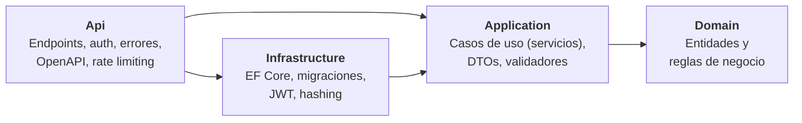

# BookingHub API

[](https://github.com/javas04/bookinghub-api/actions/workflows/ci.yml)


🇬🇧 [Read in English](README.md)

API REST para reservar espacios de oficina compartidos (salas de reuniones, escritorios y cabinas telefónicas), hecha con **ASP.NET Core 10** y Clean Architecture.

Los usuarios se registran, ven los espacios, consultan la disponibilidad y reservan franjas horarias. La API rechaza reservas solapadas, en el pasado, que superen el aforo y otras peticiones inválidas. Los administradores gestionan el catálogo de espacios y pueden ver todas las reservas.

## 🌐 Demo en vivo

**[bookinghub-api-6znt.onrender.com](https://bookinghub-api-6znt.onrender.com)**: documentación interactiva (Scalar), lista para probar.

1. Abre `POST /api/auth/register`, crea una cuenta y copia el `accessToken`.
2. Pulsa **Authentication**, pega el token y prueba `GET /api/spaces` y `POST /api/bookings`.

> Está en el plan gratuito de Render: tras un rato sin uso, la primera petición puede tardar unos 50 s mientras el servicio se despierta. Los datos de demo se reinician en cada reinicio.

## Funcionalidades

- **Autenticación JWT** con autorización por roles (`Member`, `Admin`)
- **Reglas de negocio en el modelo de dominio**: sin solapamientos (intervalos semiabiertos), duración de 15 min a 8 h, solo fechas futuras, límite de aforo y cancelación solo antes del inicio
- **Paginación, filtros y búsqueda** en los listados
- **Validación** con FluentValidation → `400` con los errores de cada campo
- **Errores homogéneos** en formato Problem Details (RFC 9457): `401/403/404/409/422`
- **Rate limiting** en login y registro para frenar ataques de fuerza bruta
- **Documento OpenAPI 3** y documentación interactiva con **Scalar**
- **Health check** para orquestadores
- **Migraciones de EF Core** que se aplican al arrancar, y datos de demo
- **55 tests automáticos**: unitarios del dominio y end-to-end de la API
- **Imagen Docker** y **CI con GitHub Actions** (formato, compilación, tests y build de la imagen)

## Stack

| Área | Elección |
|---|---|
| Runtime | .NET 10, ASP.NET Core Minimal APIs |
| Datos | EF Core 10 + SQLite |
| Auth | JWT Bearer, hash PBKDF2 (hasher de ASP.NET Core Identity) |
| Validación | FluentValidation |
| Docs de la API | Microsoft.AspNetCore.OpenApi + Scalar |
| Tests | xUnit, WebApplicationFactory, SQLite en memoria |
| DevOps | Docker, Docker Compose, GitHub Actions, gestión centralizada de paquetes |

## Arquitectura



Las dependencias apuntan hacia dentro: el **Domain** no depende de nada, y **Application** define las interfaces (`IAppDbContext`, `ITokenService`, `IPasswordHasher`, `ICurrentUser`) que implementan las capas externas.

## Cómo ejecutarlo

### Opción 1: SDK de .NET (sin nada más)

Necesitas el [SDK de .NET 10](https://dotnet.microsoft.com/download).

```bash
git clone https://github.com/javas04/bookinghub-api.git
cd bookinghub-api
dotnet run --project src/BookingHub.Api
```

Abre **http://localhost:5281** para ver la documentación interactiva. En Development la base de datos se crea sola, con espacios de demo y una cuenta de administrador:

| Email | Contraseña |
|---|---|
| `admin@bookinghub.local` | `Admin123!` |

> Estas credenciales y la clave JWT de `appsettings.Development.json` son solo para desarrollo local. En otros entornos deben venir de variables de entorno o de un gestor de secretos.

### Opción 2: Docker

```bash
cp .env.example .env   # y edita los valores
docker compose up --build
```

La API queda en **http://localhost:8080**, y la base de datos SQLite se guarda en un volumen.

## Tests

```bash
dotnet test
```

Los tests de integración levantan la API real en memoria con `WebApplicationFactory`, y cada clase de tests usa su propia base SQLite en memoria. Migraciones, seed, autenticación, validación y manejo de errores funcionan igual que en producción. **No hace falta Docker ni una base de datos externa.**

## Decisiones técnicas

- **Las reglas de negocio viven en las entidades.** `Booking.Create` y `Booking.Cancel` garantizan los invariantes, así que no se puede construir una reserva inválida. La regla de solapamiento es una `Expression` (`Booking.ConflictsWith`): el mismo código lo traduce EF Core a SQL y lo ejecutan los tests unitarios en memoria.
- **Sin capa de repositorios encima de EF Core.** `DbSet<T>` ya es un repositorio con unidad de trabajo; Application depende de una interfaz `IAppDbContext`.
- **Minimal APIs agrupadas por funcionalidad** en lugar de controladores, con endpoint filters para la validación.
- **404 en vez de 403 para reservas ajenas**, para que no se puedan sondear los IDs.
- **Todo en UTC.** Las fechas se normalizan al entrar, y los converters de EF Core garantizan `DateTimeKind.Utc` al leer.
- **Configuración validada al arrancar** (`ValidateOnStart`): la app no arranca sin una clave JWT de al menos 32 caracteres.
- **SQLite** para que el proyecto funcione con clonar y ejecutar. Pasar a PostgreSQL o SQL Server es cambiar una llamada `Use*` y regenerar las migraciones.

## Limitaciones conocidas y próximos pasos

- [ ] **Concurrencia:** dos peticiones simultáneas para la misma franja podrían pasar las dos la comprobación de solapamiento. En PostgreSQL se resolvería con una exclusion constraint (`EXCLUDE USING gist`) o una transacción serializable.
- [ ] Refresh tokens y revocación
- [ ] Reservas recurrentes
- [ ] Horarios de apertura y zonas horarias por sede
- [ ] Notificaciones por email (worker en segundo plano + outbox)
- [x] Desplegar una demo pública (Render)
