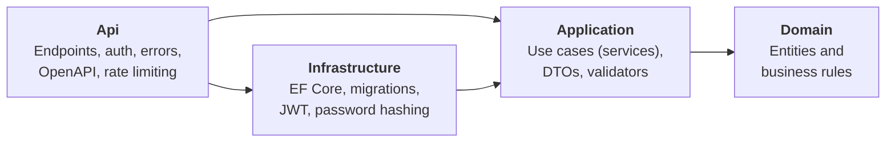

# BookingHub API

[](https://github.com/javas04/bookinghub-api/actions/workflows/ci.yml)


🇪🇸 [Leer en español](README.es.md)

A REST API for booking shared office spaces (meeting rooms, hot desks and phone booths), built with **ASP.NET Core 10** using Clean Architecture.

Members sign up, browse spaces, check availability and book time slots. The API rejects double bookings, bookings in the past, over-capacity bookings and other invalid requests. Admins manage the catalogue of spaces and can see every booking.

## 🌐 Live demo

**[bookinghub-api-6znt.onrender.com](https://bookinghub-api-6znt.onrender.com)**: interactive API docs (Scalar), ready to try.

1. Open `POST /api/auth/register`, create an account and copy the `accessToken`.
2. Click **Authentication**, paste the token, and try `GET /api/spaces` and `POST /api/bookings`.

> Hosted on Render's free plan: after a period of inactivity the first request can take ~50 s while the service wakes up. Demo data is reset on every restart.

## Features

- **JWT authentication** with role-based authorization (`Member`, `Admin`)
- **Booking rules in the domain model**: no overlaps (half-open intervals), 15 min – 8 h duration, future start only, capacity limits, cancel-before-start
- **Paging, filtering and search** on list endpoints
- **Request validation** with FluentValidation → `400` with per-field errors
- **Consistent errors** as RFC 9457 Problem Details (`401/403/404/409/422`)
- **Rate limiting** on login/register to slow down brute-force attempts
- **OpenAPI 3** document + interactive docs with **Scalar**
- **Health check** endpoint for orchestrators
- **EF Core migrations** applied on startup, plus demo data seeding
- **55 automated tests**: domain unit tests + end-to-end API tests
- **Docker** image and **GitHub Actions** CI (format, build, test, image build)

## Tech stack

| Area | Choice |
|---|---|
| Runtime | .NET 10, ASP.NET Core Minimal APIs |
| Data | EF Core 10 + SQLite |
| Auth | JWT Bearer, PBKDF2 password hashing (ASP.NET Core Identity hasher) |
| Validation | FluentValidation |
| API docs | Microsoft.AspNetCore.OpenApi + Scalar |
| Tests | xUnit, WebApplicationFactory, in-memory SQLite |
| DevOps | Docker, Docker Compose, GitHub Actions, central package management |

## Architecture



Dependencies point inwards: the **Domain** has no dependencies, and the **Application** layer defines the interfaces (`IAppDbContext`, `ITokenService`, `IPasswordHasher`, `ICurrentUser`) that the outer layers implement.

```
src/
  BookingHub.Domain/          Booking, Space, User + their invariants
  BookingHub.Application/     AuthService, SpaceService, BookingService, DTOs, validators
  BookingHub.Infrastructure/  AppDbContext, migrations, seeding, JWT, hashing
  BookingHub.Api/             Program.cs, endpoint groups, exception handler
tests/
  BookingHub.UnitTests/         Domain rules and validators
  BookingHub.IntegrationTests/  Full HTTP tests against the real pipeline
```

## Getting started

### Option 1: .NET SDK (no other dependencies)

Requires the [.NET 10 SDK](https://dotnet.microsoft.com/download).

```bash
git clone https://github.com/javas04/bookinghub-api.git
cd bookinghub-api
dotnet run --project src/BookingHub.Api
```

Open **http://localhost:5281** to get the interactive API docs. In Development the database is created automatically, with demo spaces and an admin account:

| Email | Password |
|---|---|
| `admin@bookinghub.local` | `Admin123!` |

> These credentials and the JWT key in `appsettings.Development.json` are for local development only. In other environments they must come from environment variables or a secret store.

### Option 2: Docker

```bash
cp .env.example .env   # then edit the values
docker compose up --build
```

The API is served at **http://localhost:8080**, and the SQLite database is kept in a named volume.

### Try it

1. `POST /api/auth/login` with the admin credentials, then copy the `accessToken`.
2. In Scalar, click **Authentication** and paste the token.
3. `GET /api/spaces`, then `POST /api/bookings` with a `spaceId` and a future time range.

The [BookingHub.Api.http](src/BookingHub.Api/BookingHub.Api.http) file contains ready-made requests for Visual Studio, VS Code or Rider.

## API overview

| Method | Route | Access | Description |
|---|---|---|---|
| `POST` | `/api/auth/register` | Public | Create a member account, returns a token |
| `POST` | `/api/auth/login` | Public | Returns a token |
| `GET` | `/api/auth/me` | User | Current user's profile |
| `GET` | `/api/spaces` | Public | List spaces (`type`, `minCapacity`, `search`, `page`, `pageSize`) |
| `GET` | `/api/spaces/{id}` | Public | Space details |
| `GET` | `/api/spaces/{id}/availability?date=YYYY-MM-DD` | Public | Busy slots for a UTC day |
| `POST` | `/api/spaces` | Admin | Create a space |
| `PUT` | `/api/spaces/{id}` | Admin | Update a space |
| `DELETE` | `/api/spaces/{id}` | Admin | Deactivate a space (soft delete) |
| `POST` | `/api/bookings` | User | Book a space |
| `GET` | `/api/bookings/me` | User | My bookings (`upcomingOnly`, paging) |
| `GET` | `/api/bookings/{id}` | Owner / Admin | Booking details |
| `POST` | `/api/bookings/{id}/cancel` | Owner / Admin | Cancel before it starts |
| `GET` | `/api/bookings` | Admin | All bookings (`spaceId`, `userId`, `status`, `fromUtc`, `toUtc`) |
| `GET` | `/health` | Public | Health check |

### Status codes

| Code | When |
|---|---|
| `400` | Malformed request or validation errors (`errors` lists the failing fields) |
| `401` | Missing/invalid token or wrong credentials |
| `403` | Authenticated but not allowed (e.g. a member creating a space) |
| `404` | Resource not found, **or another user's booking** (its existence is not revealed) |
| `409` | Duplicate email, or the time slot is already taken |
| `422` | A business rule failed (past date, over capacity, inactive space…) |
| `429` | Too many login/register attempts |

## Running the tests

```bash
dotnet test
```

The integration tests start the real API in memory with `WebApplicationFactory`, each test class against its own in-memory SQLite database. Migrations, seeding, authentication, validation and error handling all run exactly as in production. **No Docker or external database is needed.**

## Design decisions

- **Business rules live in the entities.** `Booking.Create` and `Booking.Cancel` enforce the invariants, so an invalid booking cannot be built. The overlap rule is an `Expression` (`Booking.ConflictsWith`), and the same code is translated to SQL by EF Core and executed in memory by the unit tests.
- **No repository layer on top of EF Core.** `DbSet<T>` already provides a repository and unit of work. The Application layer depends on an `IAppDbContext` interface instead.
- **Minimal APIs grouped by feature** instead of controllers. There is less ceremony, and endpoint filters handle validation.
- **404 instead of 403 for other people's bookings**, so booking IDs can't be probed.
- **Everything in UTC.** Values are normalized at the boundary, and EF Core converters guarantee `DateTimeKind.Utc` when reading.
- **Configuration is read lazily** through the options pattern and validated on startup (`ValidateOnStart`). The app refuses to start without a JWT key of at least 32 characters.
- **SQLite** keeps the project clone-and-run with zero setup. Switching to PostgreSQL or SQL Server means changing one `Use*` call and regenerating the migrations.

## Known limitations and roadmap

- [ ] **Concurrency:** two simultaneous requests for the same slot could both pass the overlap check. On PostgreSQL this would be closed with an exclusion constraint (`EXCLUDE USING gist`) or a serializable transaction.
- [ ] Refresh tokens and token revocation
- [ ] Recurring bookings
- [ ] Opening hours and time zones per location
- [ ] Email notifications (background worker + outbox)
- [x] Deploy a public demo (Render)
